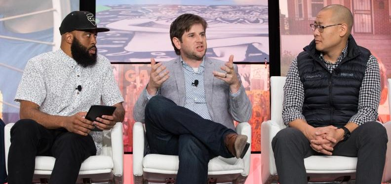

# Consulting (Archived from svozar.com/consulting — Aug 2020)

*Photo by Dustin Walsh*

I am available to consult on projects related to Autonomy, Robotics, IoT, and Mobility.

---

## Technical Leadership

Targeted at small companies or teams, I provide technical leadership, acting in a capacity similar to part-time Team Lead, VP of Engineering, or CTO to assist with a variety of organizational and technical functions, including:

- Organizational planning, including org chart, hiring roadmap and even recruiting strategy
- Product roadmap and technical milestones
- Intellectual property and patent strategy
- Software toolchain and process management and automation
- Leadership mentoring and coaching

*CTA: Let's talk! (`/contact/?subject=Technical Leadership`)*

---

## Product Strategy

Targeted at established teams, I can provide expert assistance in ideating, iterating, and implementing products for the robotics, self-driving, and IoT fields. Having been a key decision-maker for a full-stack AV company, I can provide expert feedback and analysis on what makes a product eye-catching to technical leaders. Whether it's software, hardware, or something in between, I'm excited to provide context and critical information about product-market fit in my domains of expertise.

*CTA: Let's talk! (`/contact/?subject=Product Strategy`)*

---

## Technical Diligence

In the secretive, competitive, and confusing world of autonomy, it can be difficult to separate hype from reality. Aimed at venture firms or M&A teams, I can provide my expert analysis and opinion regarding companies or technologies in the mobility, robotics, and autonomy world to give peace of mind to potential investors or acquirers that they are making a sound investment from a technical perspective.

*CTA: Let's talk! (`/contact/?subject=Technical Diligence`)*

---

Don't see what you need? Contact me (`/contact/`) to set up an appointment to discuss how we might be able to work together.
